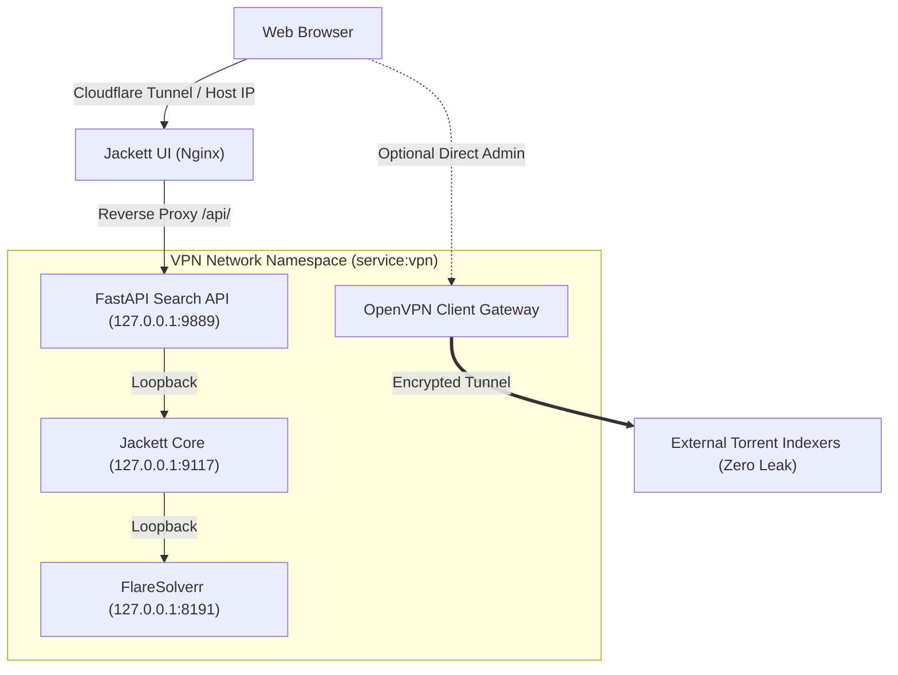

# Jackett Plus (`jackett-plus`)

[](LICENSE)
[](https://github.com/bharathganji/jackett-plus/actions/workflows/ci.yml)
[](https://github.com/semantic-release/semantic-release)
[](CONTRIBUTING.md)

Unified, open-source, all-in-one Jackett torrent indexer suite orchestrated via Docker Compose:
1. **OpenVPN Gateway & Kill-Switch (`vpn`)**: Cryptographically confines all indexer lookups, scrapes, and network traffic through an OpenVPN tunnel with zero-leak protection.
2. **FlareSolverr (`flaresolverr`)**: Bypasses Cloudflare anti-bot verification challenges for indexers.
3. **Jackett Core (`jackett`)**: Torrent indexer proxy managing public and private trackers.
4. **Jackett Python API (`api`)**: Asynchronous FastAPI streaming backend with Server-Sent Events (SSE) and indexer caching.
5. **Jackett Search UI (`ui`)**: Modern React 19 + TypeScript + Tailwind CSS web interface with virtualized torrent streams and search filtering.

---

## Architecture & Ports

- **`UI_PORT` (Default: `3001`)**: Modern Search Web UI (Nginx reverse-proxying `/api/*` to FastAPI).
- **`SEARCH_PORT` (Default: `9117`, Optional)**: Native Jackett Administrative UI (for indexer configuration and tracker management).
- **`API_PORT` (Default: `9889`, Optional)**: Direct access to FastAPI backend (if testing outside Nginx).



---

## Quick Start

### 1. Clone the Repository
```bash
git clone https://github.com/bharathganji/jackett-plus.git
cd jackett-plus
```

### 2. Configure Environment & VPN
Copy the template configuration:
```bash
cp .env.example .env
```

#### Option A: Using Free OpenVPN Profiles (VPNBook)
1. Download a free OpenVPN profile bundle (e.g. UDP 25000 or TCP 443) from [VPNBook Free OpenVPN](https://www.vpnbook.com/freevpn/openvpn).
2. Extract the archive and copy your chosen `.ovpn` file to `vpn/vpn.conf`:
   ```bash
   cp vpnbook-fr2311-udp25000.ovpn vpn/vpn.conf
   ```
3. Copy the current rotating password from [VPNBook](https://www.vpnbook.com/freevpn/openvpn) and configure `VPN_AUTH` in `.env`:
   ```env
   VPN_AUTH=vpnbook.com;vpnbook;your_password_here
   ```

#### Option B: Using Any Commercial / Private OpenVPN Provider
Place your custom `.ovpn` configuration file at `vpn/vpn.conf` and provide your credentials via `VPN_AUTH` or embedded in `vpn.conf`.

### 3. Launch the Stack
```bash
docker compose up -d --build
```

### 4. Verify VPN Kill-Switch Protection
Run a curl command inside the VPN gateway to verify your public IP is that of the VPN provider:
```bash
docker compose exec vpn curl -s https://ipinfo.io/ip
```

### 5. Access Interfaces
- **Modern Search UI:** [http://localhost:3001](http://localhost:3001)
- **Jackett Native Admin:** [http://localhost:9117](http://localhost:9117)

---

## Cloudflare Tunnel Ingress

Because the `ui` service serves static assets and reverse-proxies `/api/` directly to the FastAPI streaming backend, you only need to expose `UI_PORT` (`3001`) over Cloudflare Tunnel.

### Ingress Configuration Example (`config.yml` or Cloudflare Dashboard)
```yaml
ingress:
  # 1. Main Search Web UI (Serves React 19 UI & streaming /api/)
  - hostname: search.yourdomain.com
    service: http://localhost:3001

  # 2. Optional: Jackett Native Admin Portal
  - hostname: jackett-admin.yourdomain.com
    service: http://localhost:9117

  # 3. Optional: Direct FastAPI SSE Endpoint
  - hostname: api-jackett.yourdomain.com
    service: http://localhost:9889

  - service: http_status:404
```

### Localhost-Only Security
In `.env`, keep `HOST_IP=127.0.0.1`:
```env
HOST_IP=127.0.0.1
UI_PORT=3001
SEARCH_PORT=9117
API_PORT=9889
```
This ensures your services are **only** accessible locally by the Cloudflare Tunnel daemon and never exposed directly to public port scans on your server's public IP.

---

## Directory Structure

```text
jackett-plus/
├── docker-compose.yml       # Unified Compose stack
├── .env.example             # Documented environment template
├── .gitleaks.toml           # Secret scanning configuration
├── .pre-commit-config.yaml  # Pre-commit hook definitions
├── release.config.cjs       # Semantic release configuration
├── LICENSE                  # GNU GPL-3.0 License
├── CODE_OF_CONDUCT.md       # Contributor Covenant v2.1
├── CONTRIBUTING.md          # Contribution & Conventional Commit guide
├── SECURITY.md              # Vulnerability disclosure policy
├── vpn/
│   ├── vpn.conf             # Active OpenVPN configuration (gitignored)
│   └── vpn.conf.example     # Sanitized OpenVPN template
├── data/
│   └── jackett/
│       ├── config/          # Jackett indexers, server configs, keys (gitignored)
│       └── downloads/       # Jackett torrent downloads (gitignored)
└── services/
    ├── api/                 # FastAPI streaming backend (Python 3.12, Uvicorn)
    └── ui/                  # React 19 search interface (TypeScript, Vite, Tailwind)
```

---

## Contributing & Semantic Versioning

Contributions are welcome! Please review [CONTRIBUTING.md](CONTRIBUTING.md) and [CODE_OF_CONDUCT.md](CODE_OF_CONDUCT.md).

We use **[Conventional Commits](https://www.conventionalcommits.org/)** for automated semantic releases:
- `feat:` triggers a minor release (`v1.1.0`)
- `fix:` triggers a patch release (`v1.0.1`)
- `BREAKING CHANGE:` triggers a major release (`v2.0.0`)

---

## Security

Please report vulnerabilities privately via [GitHub Security Advisories](https://github.com/bharathganji/jackett-plus/security/advisories/new) or refer to [SECURITY.md](SECURITY.md). Do not open public issues for security vulnerabilities.

---

## Legal Disclaimer & DMCA Policy

This software is provided for educational, research, and legitimate data-aggregation purposes only (such as searching public-domain archives, creative commons works, and open-source operating system distribution images).

1. **Non-Affiliation:** `jackett-plus` is an independent open-source project and is not affiliated with, sponsored by, or endorsed by the Jackett development team or any third-party torrent indexers.
2. **No Content Hosting:** `jackett-plus` does not host, index, cache, or distribute any media files, torrent metadata, or copyrighted materials. All searches are proxied directly between the user's self-hosted Jackett instance and external indexers configured by the operator.
3. **User Responsibility:** Users of this software are solely responsible for ensuring that their use complies with all applicable local, national, and international laws, regulations, and third-party terms of service. The developers assume no liability for any misuse of this software.

---

## License

Distributed under the **GNU General Public License v3.0** (GPL-3.0). See [LICENSE](LICENSE) for more information.
